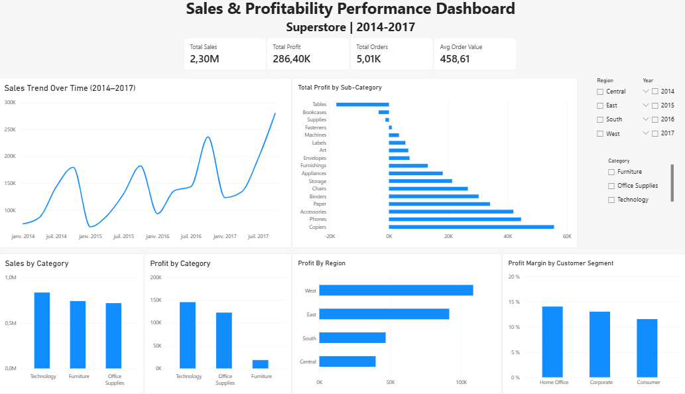

# Sales Analysis

## Project Overview

This project analyzes a retail sales dataset to uncover trends in sales and profitability, identify high-performing product categories, and understand how different business factors affect overall performance.

The analysis was performed using **Python** for data cleaning and exploratory data analysis (EDA), and **Power BI** for interactive data visualization and dashboard development.

---

## Power BI Dashboard

---

## Objectives

The main objectives of this project are to:

* Analyze overall sales and profit performance
* Identify sales and profit trends over time
* Compare product categories and sub-categories
* Analyze regional and customer-segment performance
* Examine the relationship between discounts, sales, and profit
* Identify key business insights that could support decision-making
* Present the findings through an interactive Power BI dashboard

---

## Dataset

The dataset contains **9,994 rows and 21 columns** covering retail orders.

Key variables include:

* Order Date
* Ship Date
* Ship Mode
* Customer
* Segment
* Country
* City
* State
* Region
* Category
* Sub-Category
* Product Name
* Sales
* Quantity
* Discount
* Profit

---

## Tools & Technologies

* **Python**

  * Pandas
  * Matplotlib
* **Jupyter Notebook**
* **Power BI**
* **GitHub**

---

## Analysis Process

### 1. Data Preparation

The dataset was inspected and prepared for analysis, including:

* Checking data types
* Converting date columns to datetime format
* Checking for missing values
* Checking for duplicate records
* Examining numerical and categorical variables

### 2. Exploratory Data Analysis

The analysis explored:

* Sales and profit distributions
* Sales trends over time
* Category and sub-category performance
* Regional performance
* Customer segments
* Quantity and discount patterns
* Relationships between sales, discounts, and profit

### 3. Data Visualization

Visualizations were created to make important patterns easier to identify.

### 4. Power BI Dashboard

An interactive Power BI dashboard was created to present the main KPIs, trends, comparisons, and business insights from the analysis.

---

## Key Findings & Business Recommendations

### 1. Sales and Profitability Overview

- **Total Sales:** $2,297,200.86
- **Total Profit:** $286,397.02
- Sales increased overall from 2014 to 2017, indicating a positive growth trend.
- Technology generated the highest sales and profit among the three main product categories.

### 2. Discount Strategy and Table Profitability

- Tables ranked fourth in total sales but generated the lowest total profit among the sub-categories.
- **63.6% of Table records resulted in a loss** (203 out of 319).
- Tables had an average discount of 26.1%.
- Discount and profit showed a negative correlation of -0.672.

**Recommendation:** Review discount policies for Tables and evaluate targeted promotions and minimum profit-margin thresholds to help reduce losses.

### 3. Customer Segment Profitability

- Consumer generated the highest total sales and profit but had the lowest profit margin (11.55%).
- Home Office achieved the highest profit margin (14.03%).

**Recommendation:** Investigate differences in purchasing behavior, product mix, and pricing across customer segments to identify opportunities to improve profitability.

### 4. High-Profit Products

- Technology was the strongest-performing main category in terms of sales and profit.
- Copiers generated the highest total profit among sub-categories despite ranking eighth in sales.

**Recommendation:** Evaluate opportunities to promote profitable Technology products, particularly Copiers, while monitoring their margins and demand.

### 5. Seasonal Sales Trends

- Sales increased overall between 2014 and 2017.
- Sales consistently peaked during the fourth quarter.
- January recorded the lowest sales each year.

**Recommendation:** Use historical seasonal patterns to inform fourth-quarter inventory and marketing plans, while evaluating targeted campaigns to strengthen January sales.

## Conclusion

This project analyzed retail sales and profitability from 2014 to 2017 using Python for data preparation and exploratory data analysis, and Power BI for interactive visualization.

The analysis identified differences in profitability across products and customer segments, highlighted potential concerns with Table discounting, and revealed seasonal sales patterns. These findings demonstrate how exploratory data analysis can support more informed decisions about pricing, promotions, product strategy, and sales planning.

---

## Project Files

- [`sales_analysis.ipynb`](sales_analysis.ipynb) — Jupyter Notebook containing data preparation, exploratory data analysis, visualizations, and findings.
- [`Sales_Analysis.pbix`](Sales_Analysis.pbix) — Power BI file containing the interactive dashboard.
- [`powerbi_dashboard.png`](powerbi_dashboard.png) — Preview of the Power BI dashboard.                                         

---

## Author

**Jouri**

Data Analyst Portfolio Project
